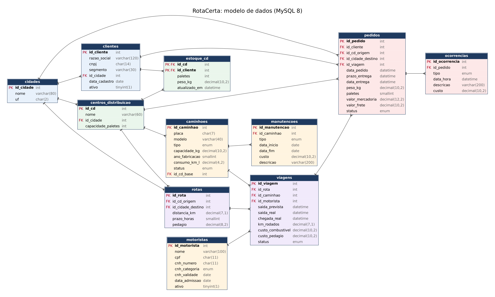

# 🚚 RotaCerta: banco de dados de uma transportadora (MySQL 8)

Projeto de portfólio que modela, popula e analisa a operação de uma **transportadora fictícia** que atende o Sudeste do Brasil: clientes, centros de distribuição, frota, motoristas, viagens, pedidos de frete e ocorrências.

O objetivo é mostrar como o SQL resolve problemas reais de logística: **regras de negócio dentro do banco** e **indicadores de desempenho** calculados direto nas consultas.

> Todos os dados são fictícios. Nenhuma empresa, pessoa, CNPJ ou CPF real é usado.

## 🧱 Modelo de dados



| Tabela | O que guarda |
|---|---|
| `cidades` | Cidades atendidas (SP, RJ, MG, ES) |
| `clientes` | Empresas que contratam o frete |
| `centros_distribuicao` | Armazéns de onde as cargas saem |
| `estoque_cd` | Paletes de cada cliente guardados em cada CD |
| `caminhoes` | Frota própria, capacidade e status |
| `manutencoes` | Histórico de manutenção preventiva e corretiva |
| `motoristas` | Motoristas, categoria e validade da CNH |
| `rotas` | Trajeto CD → cidade, distância e prazo (SLA) |
| `viagens` | Caminhão + motorista + rota, previsto x realizado |
| `pedidos` | Fretes contratados: peso, valor, prazo e entrega |
| `ocorrencias` | Atrasos, avarias, cliente ausente, extravios |

**Integridade garantida pelo banco:** chaves primárias e estrangeiras, `CHECK` (UF do Sudeste, peso > 0, prazo depois do pedido, datas coerentes), `UNIQUE` (placa, CNPJ, CPF, CNH) e índices para os relatórios.

## 🗂️ Etapas do projeto

| Etapa | Conteúdo | Status |
|---|---|---|
| 01 | Modelagem: DDL, PK/FK, CHECK, índices e diagrama ER | ✅ |
| 02 | Dados fictícios realistas (~1 ano de operação) | ⏳ |
| 03 | Triggers, procedures e transações (capacidade do caminhão, CNH vencida, SLA, armazém) | ⏳ |
| 04 | Consultas avançadas com CTE e window functions (OTD, ocupação da frota, custo/km, curva ABC) | ⏳ |
| 05 | Views para relatórios | ⏳ |

## ▶️ Como executar

1. Instale o **MySQL 8.0.16+** (e, se quiser, o MySQL Workbench).
2. Rode os scripts na ordem das pastas:
   ```bash
   mysql -u root -p < etapa-01-modelagem/01_criar_tabelas.sql
   ```
3. Cada pasta tem um `GUIA_ETAPA_X.md` explicando o porquê de cada comando.

## 🛠️ Tecnologias

MySQL 8 · MySQL Workbench · Git/GitHub

## 👤 Autor

**Ricardo** · [LinkedIn](https://www.linkedin.com/in/ricardo-ag-4928bb3a1) · [GitHub](https://github.com/RICKllh)
